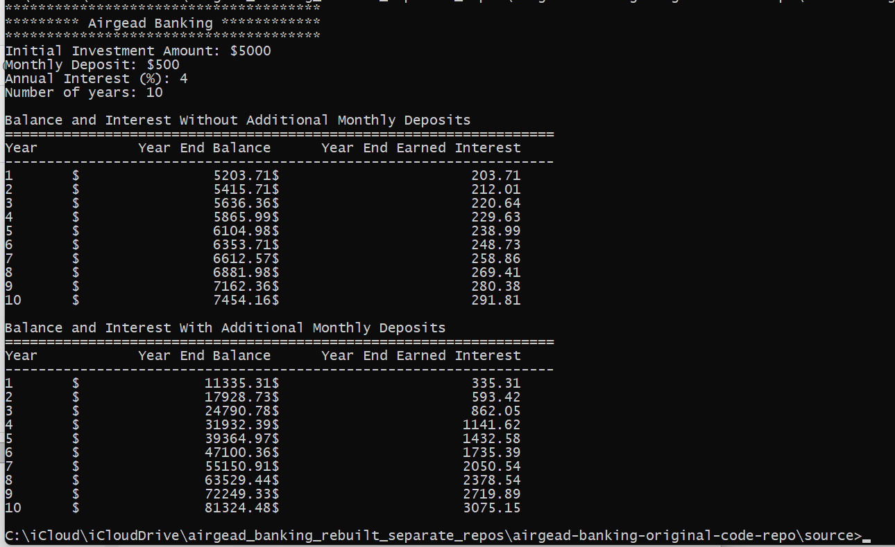
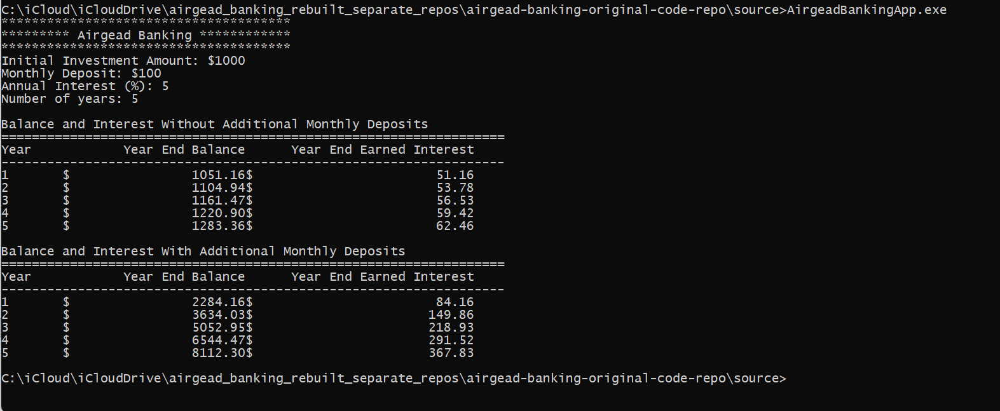

<!--
Document: Airgead Banking — Original C++ Source
Purpose: Documents the original C++ application's requirements, source structure, build workflow, and relationship to the browser demo.
Author: Alysha Pursley
Copyright (c) 2026 Alysha Pursley.
-->

# Airgead Banking — Original C++ Source

This folder contains my C++ console implementation of the Airgead Banking investment-growth application. I keep it alongside the browser demo because the two interfaces show different parts of the same project: the C++ source preserves the original console application and object-oriented implementation, while the browser demo provides a static version that can run directly on GitHub Pages.

## Business context

The project scenario presents Airgead Banking as a client of Chada Tech. The application illustrates fiscal responsibility, investing, and the effects of compound interest over time.

## Required console behavior

I built the C++ application to:

- accepts an initial investment amount
- accepts a recurring monthly deposit
- accepts an annual interest rate
- accepts 1–1,000 years (a safeguard against unbounded reports and memory use)
- pauses after input so the user can confirm before the reports are displayed
- shows year-end balance and earned interest without additional monthly deposits
- shows year-end balance and earned interest with the entered monthly deposit
- compounds interest monthly
- can be rerun with different inputs to compare scenarios

For the monthly-deposit calculation, the monthly interest follows the required order:

`(opening balance + monthly deposit) * ((annual interest / 100) / 12)`

The resulting interest is added to the month's total to produce the closing balance.

## Source structure

- `airgead_banking_app.cpp` — console entry point and validated input
- `investment.h` — investment data/result types and public interface
- `investment.cpp` — monthly compounding and report output
- `tests/investment_test.cpp` — deterministic regression tests for the established calculation behavior

## Build and test

From the `Original/` directory:

```bash
g++ -std=c++17 -Wall -Wextra -Wpedantic airgead_banking_app.cpp investment.cpp -o airgead
./airgead
```

To compile and run the C++ regression test:

```bash
g++ -std=c++17 -Wall -Wextra -Wpedantic tests/investment_test.cpp investment.cpp -o investment_test
./investment_test
```

## Relationship to the browser demo

I built the browser companion separately because GitHub Pages cannot execute my C++ console program. The website recreates the calculation in HTML, CSS, and JavaScript so visitors can explore it interactively.

I keep the C++ code as the reference implementation for the original Airgead Banking console requirements. My browser companion adds charts, browser-local saved plans, scenario comparison, and CSV export.

I preserved the same contribution timing in both implementations: I add each monthly deposit before calculating that month's interest. My browser interface remains a separate static implementation; I do not claim that GitHub Pages executes my C++ program.

## Original console screenshots

I included two screenshots of the console application as supporting portfolio evidence:





## Copyright and licensing

I included `LICENSE` to document the copyright and current reuse status of my C++ source. That notice does not grant an open-source license.
