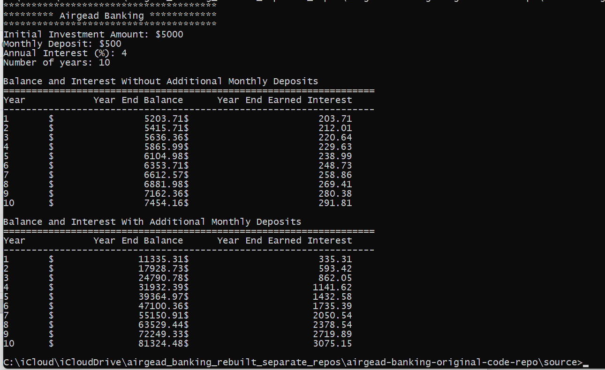
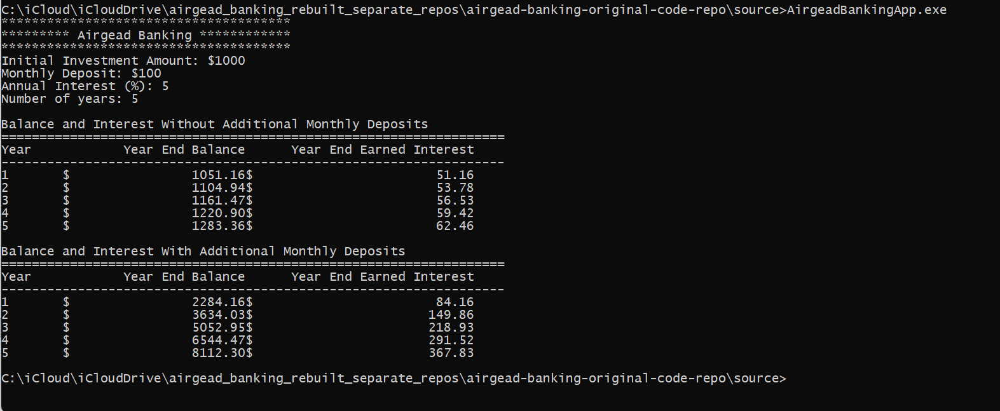

<!--
File: README.md
Document Title: Airgead Investment Calculator
Author: Alysha Pursley
Date: August 2026
-->

<div align="center">


<h1>Airgead Investment Calculator 💰</h1>

<p>
   <a href="https://github.com/apursley2012/airgead-investment-calculator/stargazers">
      
   </a> 
   <a href="https://github.com/apursley2012/airgead-investment-calculator/forks">
      
   </a> 
   <a href="https://github.com/apursley2012/airgead-investment-calculator/issues">
      
   </a>
   <a href="https://github.com/apursley2012/airgead-investment-calculator/commits">
      
   </a> 
   <a href="https://github.com/apursley2012/airgead-investment-calculator">
      
   </a>
   <a href="https://github.com/apursley2012/airgead-investment-calculator">
      
   </a>
</p>

<p>
   
    
    
   
</p>

<p><strong>An investment-growth calculator that compares compound-interest outcomes with and without monthly deposits, shows year-by-year results, and lets users explore and save planning scenarios.</strong></p>

<p><a href="https://apursley2012.github.io/airgead-investment-calculator/">Open the live project</a> · <a href="https://github.com/apursley2012/airgead-investment-calculator">View the repository</a> · <a href="https://github.com/apursley2012/airgead-investment-calculator/issues/new/choose">Report an issue or request an addition</a></p>

</div>

---

## Table of Contents 📖

*   [Project Overview 🔎](#project-overview)
    *   [Purpose 🎯](#purpose)
    *   [Design Style and Inspiration 🎨](#design-style-and-inspiration)
    *   [Main Color Palette 🌈](#main-color-palette)
    *   [Preview Screenshots 🖼️](#preview-screenshots)
*   [Key Features ✨](#key-features)
*   [Tech Stack 🛠️](#tech-stack)
*   [Live Demo 🚀](#live-demo)
*   [Installation 📦](#installation)
    *   [Local Use 💻](#local-use)
    *   [GitHub Pages Deployment 🌐](#github-pages-deployment)
*   [Usage 🧭](#usage)
*   [Project Structure 🗂️](#project-structure)
    *   [Pages Included 📄](#pages-included)
    *   [Core Files and Architecture 🧩](#core-files-and-architecture)
    *   [File and Folder Structure 🌳](#file-and-folder-structure)
*   [Calculation Model 🧮](#calculation-model)
*   [Customization Guide 🎨](#customization-guide)
*   [Accessibility and Browser Compatibility ♿](#accessibility-and-browser-compatibility)
*   [Repository Relationship 🔗](#repository-relationship)
*   [Project Scope and Limitations 📌](#project-scope-and-limitations)
*   [Possible Future Enhancements 💡](#possible-future-enhancements)
*   [Contributing 🤝](#contributing)
    *   [Reporting Issues 🐛](#reporting-issues)
    *   [Requesting Additions 📝](#requesting-additions)
*   [License 📜](#license)
*   [Important Links 🔗](#important-links)
*   [Attribution ℹ️](#attribution)

---

<a id="project-overview"></a>

<details open>
<summary><h2><strong>Project Overview 🔎</strong></h2></summary>


**Airgead Investment Calculator** is an investment-growth tool for comparing long-term savings scenarios with and without recurring monthly contributions. It turns principal, contribution, rate, and time inputs into projected balances so the effect of compound growth is easier to understand.

I designed the calculator to answer more than “what will the ending balance be?” The comparison between no-deposit growth and recurring-deposit growth makes the impact of saving habits visible, while the year-by-year results provide enough detail to understand how the balance changes over time rather than presenting a single unexplained number.

The project keeps the calculation model and presentation closely connected. Inputs are intentionally direct, results are structured for comparison, and the supporting implementation makes the formulas and assumptions easier to inspect, test, and explain.

</details>

<a id="purpose"></a>

<details open>
<summary><h3><strong>Purpose 🎯</strong></h3></summary>


I created **Airgead Investment Calculator** to help people understand how consistent saving changes long-term investment growth, not just produce a final balance. The calculator lets someone compare the same investment plan with and without recurring monthly deposits so the effect of contribution habits is visible alongside compound interest. My goal was to make common investment-growth scenarios easier to explore, compare, save, and explain without requiring someone to build a spreadsheet first.
</details>

<a id="design-style-and-inspiration"></a>

<details open>
<summary><h3><strong>Design Style and Inspiration 🎨</strong></h3></summary>


I designed **Airgead Investment Calculator** around a restrained financial-planning design instead of a high-gloss fintech look. Forest green provides structure and identifies primary controls, gold adds selective emphasis, and cream and paper surfaces keep forms, projections, tables, and explanations easy to read. The layout is centered on entering assumptions, comparing outcomes, and understanding the effect of recurring contributions, so the visual treatment supports the calculations rather than competing with them.

</details>

<a id="main-color-palette"></a>

<details open>
<summary><h3><strong>Main Color Palette 🌈</strong></h3></summary>


I pulled the palette below directly from the current project stylesheet `css/shared.css`.

Each row identifies a color defined in the current stylesheet and its principal uses in the interface.

| Hex | CSS token / color | Specific use in the interface |
| --- | --- | --- |
| `#004f12` | `--airgead-green` · Airgead green | Typed Airgead Banking name in the shared navigation brand. |
| `#082d1d` | `--green-950` · Deep forest | Footer background, keyboard-only skip-link background, and deep shadow tones. |
| `#0b3f29` | `--green-900` · Heading green | Main H1 and H2 headings across the site. |
| `#0f5132` | `--green-800` · Primary green | Primary buttons, form labels, focus outlines, active navigation text, positive figures, and article links. |
| `#166b42` | `--green-700` · Accent green | Small uppercase section labels and hover state for primary buttons. |
| `#dfeee5` | `--green-100` · Pale sage | Feature icon backgrounds and the homepage's green gradient stop. |
| `#c8a24a` | `--gold` · Gold | Article callout borders, focused input border treatment, and hero accents. |
| `#ead9a6` | `--gold-200` · Light gold | Footer section headings, focus treatment in the dark footer, and hero accents. |
| `#f5f3f0` | `--canvas` · Warm gray | Standard page background and the hero gradient's neutral end. |
| `#fbf7ed` | `--parchment` · Cream | Light-on-dark button text, article callout backgrounds, and the hero gradient's warm start. |
| `#fffefb` | `--paper` · Off-white | Default shared-card background. |
| `#ffffff` | `--white` · White | Form input backgrounds, soft buttons, and light table surfaces. |
| `#16251e` | `--ink` · Dark ink | Default body and input text; also used in chart annotations. |
| `#656d67` | `--muted` · Muted gray-green | Less prominent supporting text and article metadata. |
| `#e7dfd0` | `--line` · Warm border | Navigation divider, input borders, cards, table-row dividers, and soft-button outlines. |

Additional alpha-hex values in the CSS provide translucent text, shadows, borders, and accents. Those are variants of the design colors, not separate primary palette entries.

</details>

<a id="preview-screenshots"></a>

<details open>
<summary><h3><strong>Preview Screenshots 🖼️</strong></h3></summary>


Click any preview image in the repository screenshot folder to open the full-size file.


#### 🖼️ Screenshot Gallery


These two screenshots show the original C++ console program and its annual balance and interest reports.

<div align="center">

<a href="assets/screenshots/airgead-console-screenshot-1.png"></a>
<a href="assets/screenshots/airgead-console-screenshot-2.png"></a>

</div>

</details>

---

<a id="key-features"></a>

<details open>
<summary><h2><strong>Key Features ✨</strong></h2></summary>


*   **Calculate compound growth from user-supplied investment inputs**
*   **Compare balances with and without monthly deposits**
*   **Include year-by-year report tables for ending balances and interest (the live Results page currently has a JavaScript import issue)**
*   **Validate calculator inputs before producing results**
*   **Save planning scenarios in browser storage (the current Results-page import issue blocks its save control until fixed)**
*   **Reopen or delete saved plans**
*   **Provide a How It Works explanation, case study, and articles**
*   **Run the browser version on static GitHub Pages hosting; the original C++ application runs separately**

</details>

---

<a id="tech-stack"></a>

<details open>
<summary><h2><strong>Tech Stack 🛠️</strong></h2></summary>


*   **C++17 (original console application)**

*   **HTML**
*   **CSS**
*   **JavaScript**
*   **Modular calculator JavaScript**
*   **Canvas API for comparison and growth charts**

*   **Local Storage for saved plans**
*   **GitHub Pages**

</details>

---

<a id="live-demo"></a>

<details open>
<summary><h2><strong>Live Demo 🚀</strong></h2></summary>


Open the published project here:

[https://apursley2012.github.io/airgead-investment-calculator/](https://apursley2012.github.io/airgead-investment-calculator/)

</details>

---

<a id="installation"></a>

<details open>
<summary><h2><strong>Installation 📦</strong></h2></summary>


</details>

<a id="local-use"></a>

<details open>
<summary><h3><strong>Local Use 💻</strong></h3></summary>


1. Clone or download the repository.
2. Keep the repository structure intact so the pages can find their styles, scripts, and images.
3. For the browser site, run `python3 -m http.server 8000` from the repository root, then open `http://localhost:8000/`. This is a local static server, not an application backend.
4. To build the original C++ program, run `g++ -std=c++17 -Wall -Wextra -Wpedantic airgead_banking_app.cpp investment.cpp -o airgead` from `Original/`, then run `./airgead`.

</details>

<a id="github-pages-deployment"></a>

<details open>
<summary><h3><strong>GitHub Pages Deployment 🌐</strong></h3></summary>


For the static/public portion, keep `index.html` at the repository root, use relative asset paths, then enable **Settings → Pages → Deploy from a branch → main → / (root)**. The `Original/` C++ console program is not executed by GitHub Pages; only the static HTML, CSS, and JavaScript browser site is published.

</details>

---

<a id="usage"></a>

<details open>
<summary><h2><strong>Usage 🧭</strong></h2></summary>


On Calculator, enter the starting balance, monthly deposit, annual interest rate, and years to see the live projection. Compare lets me test two sets of assumptions. Saved Plans stores named scenarios in the current browser and lets me reopen or delete them. Results is intended to display annual tables, charts, and export controls, but its current live JavaScript import is broken (see Project Scope and Limitations).

</details>

---

<a id="project-structure"></a>

<details open>
<summary><h2><strong>Project Structure 🗂️</strong></h2></summary>


</details>

<a id="pages-included"></a>

<details open>
<summary><h3><strong>Pages Included 📄</strong></h3></summary>


| Page / Area | Purpose |
| --- | --- |
| `index.html` | Homepage with the Airgead Banking hero image, short feature cards, and links to the calculator, calculation guide, and case study. |
| `404.html` | Custom not-found message with home/calculator links and a script that resolves GitHub Pages repository subpaths for missing URLs. |
| `pages/calculator.html` | Starting balance, monthly deposit, annual rate, and years controls, populated by JavaScript; live projected totals and **View Details** form. |
| `pages/results.html` | Markup for projected balances, total principal, total interest, the growth chart, two annual report tables, **Save Plan**, and **Export CSV**. Its controller currently has an unresolved report-table import. |
| `pages/compare.html` | Two independent sets of investment inputs, final balance summaries, and a chart dividing each result into contributed principal and interest. |
| `pages/saved-plans.html` | Container populated with validated saved-plan cards, including **View Results** and confirmed **Delete** actions; an empty state links back to Calculator. |
| `pages/how-it-works.html` | Step-by-step explanation of input assumptions, deposit-before-interest monthly compounding, annual results, comparison, and browser-local saving. |
| `pages/articles.html` | Index linking to the two substantive financial-planning articles. |
| `pages/article-monthly-deposits.html` | Article explaining principal versus earned interest, deposit timing, annual reports, and controlled scenario comparisons. |
| `pages/article-budget-before-investing.html` | Article on choosing a realistic monthly contribution after expenses, irregular costs, emergency savings, debt, and savings goals. |
| `pages/blog.html` | Three development-journal sections covering the browser version, explaining results clearly, and handling browser-local data. |
| `pages/case-study.html` | Explanation of project goals, C++ and browser architecture, calculation rules, visual design, storage, accessibility, testing, and technical trade-offs. |
| `pages/login.html` | Labeled demonstration sign-in form that records only a temporary session flag; it creates no user account. |
| `pages/privacy.html` | Notice about locally stored plans and calculations, demo session state, font requests, hosting, and browser-data clearing. |
| `pages/terms.html` | **Current repository issue:** This file contains the Saved Plans page markup and script instead of Terms of Use content. The footer's Terms link therefore points to the wrong page. |
| `pages/disclaimer.html` | Financial-model assumptions, omitted real-world factors, and the distinction between illustrations and advice. |
| `pages/accessibility.html` | Accessibility features, known testing limitations, and a means to report usability barriers. |

</details>

<a id="core-files-and-architecture"></a>

<details open>
<summary><h3><strong>Core Files and Architecture 🧩</strong></h3></summary>


The site shares UI behavior without moving ordinary article or page copy into large JavaScript data objects. Each CSS page file loads after `css/shared.css` on its corresponding page.

**Stylesheets**

| File | Specific responsibility |
| --- | --- |
| `css/shared.css` | Design tokens, body/display fonts, navigation and footer, reusable cards/buttons, labels and inputs, tables, layout utilities, focus styles, and shared responsive breakpoints. |
| `css/pages/index.css` | Homepage hero background and circular accents, hero wordmark sizing, action layout, and mobile hero adjustments. |
| `css/pages/calculator.css` | Large projected-balance display, investment form deck, and quick-stat arrangement. |
| `css/pages/results.css` | Results-page summary cards, chart space, report tables, and save/export toolbar layout. |
| `css/pages/compare.css` | Two-scenario cards, comparison metric tiles, and chart/responsive arrangement. |
| `css/pages/saved-plans.css` | Saved-plan card grid, delete/open actions, and empty-state presentation. |
| `css/pages/login.css` | Demo sign-in card spacing, logo size, form layout, and consistent full-width inputs. |
| `css/pages/case-study.css` | Case-study-specific logo panel and image presentation. |
| `css/pages/not-found.css` | Shared-theme presentation for the 404 page when the custom page resolves the site root. |

**Shared JavaScript components**

| File | Specific responsibility |
| --- | --- |
| `js/components/brand.js` | Generates the shared home link with the symbol-only Airgead logo and separately rendered brand name. |
| `js/components/navigation.js` | Builds desktop/mobile navigation, active-page indicators, keyboard menu behavior, and demo sign-out action. |
| `js/components/footer.js` | Creates the footer's brand, tool and project links, and privacy/terms/disclaimer/accessibility links. The current Terms destination exists but contains the wrong page content. |
| `js/components/shell.js` | Inserts the shared navigation, footer, and toast region on pages and resolves page-relative paths for normal and 404 routes. |
| `js/components/page-header.js` | Builds repeated eyebrow, heading, and introductory text from attributes on individual page elements. |
| `js/components/investment-fields.js` | Produces labeled starting balance, monthly deposit, annual rate, and years inputs for Calculator and both Compare scenarios. |
| `js/components/plan-card.js` | Builds saved-plan cards using text nodes for user-supplied names, plus date, balance, open, and delete controls. |
| `js/components/report-table.js` | **Current repository issue:** contains a duplicate of `plan-card.js` instead of the expected `renderReportTables()` export. The Results controller depends on that missing export. |
| `js/components/toast.js` | Creates an accessible live-status region and displays brief feedback such as save or storage-error messages. |

**Calculation, data, and page controllers**

| File | Specific responsibility |
| --- | --- |
| `js/lib/calculator.js` | Validates and normalizes numeric inputs, calculates 12 monthly steps per year with deposits before interest, returns annual values, and formats currency. |
| `js/lib/charts.js` | Draws the yearly growth lines and the scenario principal/interest comparison with the Canvas 2D API. |
| `js/lib/csv-export.js` | Escapes CSV fields, protects spreadsheet-leading formula characters, creates a browser Blob, and triggers a file download. |
| `js/lib/plan-storage.js` | Reads/writes current calculations and saved plans, rejects invalid records, recalculates stored results to check integrity, and manages plan IDs. |
| `js/pages/calculator.js` | Connects form inputs to the live calculation, handles invalid projections, animates the displayed total, and saves a calculation before Results navigation. |
| `js/pages/compare.js` | Reads Scenario A/B forms independently, recalculates totals, displays input errors, and redraws the comparison chart. |
| `js/pages/results.js` | Populates balances and yearly rows, draws the growth chart, and handles plan saving and CSV export; currently blocked by the report-table import mismatch. |
| `js/pages/saved-plans.js` | Loads valid plans, renders cards/empty state, reopens saved inputs, confirms deletion, and refreshes on another tab's storage changes. |
| `js/pages/login.js` | Handles demonstration sign-in by setting a temporary `sessionStorage` indicator and navigating to Saved Plans without saving credentials. |

**Original C++ source and project notices**

| File | Specific responsibility |
| --- | --- |
| `Original/airgead_banking_app.cpp` | Console entry point; collects validated inputs and runs both annual investment reports. |
| `Original/investment.h` | Declares the investment model, result structure, and calculation interface. |
| `Original/investment.cpp` | Implements validation, monthly compounding, and annual report formatting for the original application. |
| `Original/tests/investment_test.cpp` | Contains deterministic C++ regression assertions for deposit timing, zero-rate results, invalid inputs, and numeric limits; this file is present on the current GitHub branch. |
| `Original/README.md` | Documents the console program, build commands, required calculations, and its relationship to the browser site. |
| `LICENSE`, `Original/LICENSE` | Proprietary copyright and reuse terms for project-owned contributions. |
| `THIRD_PARTY_NOTICES.md` | Identifies externally loaded Inter and Fraunces fonts and reproduces the applicable SIL Open Font License. |

</details>

<a id="file-and-folder-structure"></a>

<details open>
<summary><h3><strong>File and Folder Structure 🌳</strong></h3></summary>


```text
airgead-investment-calculator/
├── README.md
├── LICENSE
├── THIRD_PARTY_NOTICES.md
├── index.html
├── 404.html
├── assets/
│   ├── logo/
│   │   ├── airgead-mark.png
│   │   └── airgead-mark-light.png
│   └── screenshots/
│       ├── airgead-console-screenshot-1.png
│       └── airgead-console-screenshot-2.png
├── css/
│   ├── shared.css
│   └── pages/
│       ├── index.css
│       ├── calculator.css
│       ├── results.css
│       ├── compare.css
│       ├── saved-plans.css
│       ├── login.css
│       ├── case-study.css
│       └── not-found.css
├── js/
│   ├── components/
│   │   ├── brand.js
│   │   ├── navigation.js
│   │   ├── footer.js
│   │   ├── shell.js
│   │   ├── page-header.js
│   │   ├── investment-fields.js
│   │   ├── plan-card.js
│   │   ├── report-table.js
│   │   └── toast.js
│   ├── lib/
│   │   ├── calculator.js
│   │   ├── charts.js
│   │   ├── csv-export.js
│   │   └── plan-storage.js
│   └── pages/
│       ├── calculator.js
│       ├── compare.js
│       ├── results.js
│       ├── saved-plans.js
│       └── login.js
├── pages/
│   ├── calculator.html
│   ├── results.html
│   ├── compare.html
│   ├── saved-plans.html
│   ├── how-it-works.html
│   ├── articles.html
│   ├── article-monthly-deposits.html
│   ├── article-budget-before-investing.html
│   ├── blog.html
│   ├── case-study.html
│   ├── login.html
│   ├── privacy.html
│   ├── terms.html
│   ├── disclaimer.html
│   └── accessibility.html
└── Original/
    ├── README.md
    ├── LICENSE
    ├── airgead_banking_app.cpp
    ├── investment.cpp
    ├── investment.h
    └── tests/
        └── investment_test.cpp
```

The tree reflects the current public `main` branch, including the static website at the repository root and the separate C++ source in `Original/`.

</details>

---

<a id="calculation-model"></a>

<details open>
<summary><h2><strong>Calculation Model 🧮</strong></h2></summary>


The core calculation keeps the two scenarios separate: growth from the starting principal alone and growth when monthly deposits continue throughout the investment period. The year-by-year tables make that difference visible rather than hiding it inside a single total.

Saved plans are browser-side convenience data in the static version. They make repeated comparisons practical without suggesting that GitHub Pages is providing a secure financial account or server-side user database.

</details>

---

<a id="customization-guide"></a>

<details open>
<summary><h2><strong>Customization Guide 🎨</strong></h2></summary>


The safest way to customize or extend **Airgead Investment Calculator** is to preserve its existing workflow first, then change one layer at a time. Update project content and data in the files that already own that information, keep visual changes inside the existing style system, and test every page that shares the changed component or data source. New features should solve a problem that belongs to this project instead of copying a feature from an unrelated application.

For visual changes, update the documented palette intentionally and re-check contrast, responsive spacing, screenshots, and any state colors that depend on the same variables. For data or logic changes, test both the normal path and empty/error/edge cases before publishing.

</details>

---

<a id="accessibility-and-browser-compatibility"></a>

<details open>
<summary><h2><strong>Accessibility and Browser Compatibility ♿</strong></h2></summary>


The public interface should remain keyboard-navigable, readable at common mobile and desktop widths, and usable without relying on color alone to communicate state. Form controls should keep visible labels or accessible names, images should use meaningful `alt` text, focus indicators should remain visible, and decorative animation should respect reduced-motion preferences when motion is present. Browser compatibility should be checked in current Safari, Chrome, Firefox, and Edge where practical.

</details>

---

<a id="repository-relationship"></a>

<details open>
<summary><h2><strong>Repository Relationship 🔗</strong></h2></summary>


This repository contains **one project with two implementations**:

- **`Original/`** contains the C++ console application required by the Airgead Banking/Chada Tech scenario.
- The **repository root** contains the interactive static website and its project material.

The C++ program generates console tables. The browser application implements the calculation separately, provides visual comparison tools, and stores plans in the browser. GitHub Pages only hosts the static site. The two implementations should not be mistaken for the same runtime.

</details>

---

<a id="project-scope-and-limitations"></a>

<details open>
<summary><h2><strong>Project Scope and Limitations 📌</strong></h2></summary>


- **Educational calculations:** A constant-rate model, not actual investment performance or personalized financial advice.
- **Static-only hosting:** No backend, bank integration, protected account, remote database, or server-side calculations.
- **Local storage:** Saved plans are available only in the same browser profile; clearing site data can remove them. The demo sign-in indicator is not authentication.
- **Browser-dependent features:** JavaScript and browser storage must be available for calculation history and plan management. CSV export creates a local download.
- **Current report-table source mismatch:** As of the November 2026 source check, `js/components/report-table.js` duplicates the saved-plan card module and lacks `renderReportTables()`, which `js/pages/results.js` imports. This needs a code correction before the Results workflow can be verified as functional.
- **Incorrect Terms page:** `pages/terms.html` currently contains Saved Plans markup rather than Terms of Use. The proprietary license remains available at `LICENSE`, but the public Terms page needs its own correct content.
- **Testing boundaries:** Source review and inspecting accessible published pages do not establish cross-browser, end-to-end, or WCAG certification. The original C++ source has deterministic regression tests in `Original/tests/`, while no root-level Node test suite was verified in the live branch.

</details>

---

<a id="possible-future-enhancements"></a>

<details open>
<summary><h2><strong>Possible Future Enhancements 💡</strong></h2></summary>


*   Add more comparison charts for long investment periods
*   Add print-ready layouts for saved plans and annual tables
*   Expand input guidance for edge cases such as zero monthly deposits
*   Add automated tests around compounding and rounding behavior

</details>

---

<a id="contributing"></a>

<details open>
<summary><h2><strong>Contributing 🤝</strong></h2></summary>


Bug reports and practical improvement suggestions are welcome through GitHub Issues. The proprietary license does not grant permission to redistribute or reuse the project-owned source.

</details>

<a id="reporting-issues"></a>

<details open>
<summary><h3><strong>Reporting Issues 🐛</strong></h3></summary>


When reporting a problem, include the page or workflow involved, what you expected, what actually happened, browser/device information when relevant, and a screenshot if the issue is visual.

</details>

<a id="requesting-additions"></a>

<details open>
<summary><h3><strong>Requesting Additions 📝</strong></h3></summary>


Feature requests should explain the user problem the addition would solve and how it fits the existing project. Project-specific improvements are preferred over adding features only because they are common in other applications.

</details>

---

<a id="license"></a>

<details open>
<summary><h2><strong>License 📜</strong></h2></summary>


Copyright © 2026 Alysha Pursley. The repository has a proprietary [`LICENSE`](LICENSE), with a separate [`Original/LICENSE`](Original/LICENSE) for the C++ application. Public availability does not grant an open-source reuse license. Third-party fonts have their own licenses described in [`THIRD_PARTY_NOTICES.md`](THIRD_PARTY_NOTICES.md).

</details>

---

<a id="important-links"></a>

<details open>
<summary><h2><strong>Important Links 🔗</strong></h2></summary>


*   **Live Project:** [https://apursley2012.github.io/airgead-investment-calculator/](https://apursley2012.github.io/airgead-investment-calculator/)
*   **Repository:** [https://github.com/apursley2012/airgead-investment-calculator](https://github.com/apursley2012/airgead-investment-calculator)
*   **Issues / Requests:** [https://github.com/apursley2012/airgead-investment-calculator/issues/new/choose](https://github.com/apursley2012/airgead-investment-calculator/issues/new/choose)

</details>

---

<a id="attribution"></a>

<details open>
<summary><h2><strong>Attribution ℹ️</strong></h2></summary>


The original application follows the Airgead Banking client scenario for Chada Tech. The website loads Inter and Fraunces through Google Fonts; their designers, copyright notices, and SIL Open Font License 1.1 are identified in [`THIRD_PARTY_NOTICES.md`](THIRD_PARTY_NOTICES.md).

</details>

---

<div align=center>
   
***Made with ❤️ and a bit of 🪄.***
<br>
**©️ 2026 Alysha Pursley. All Rights Reserved.**

</div>

